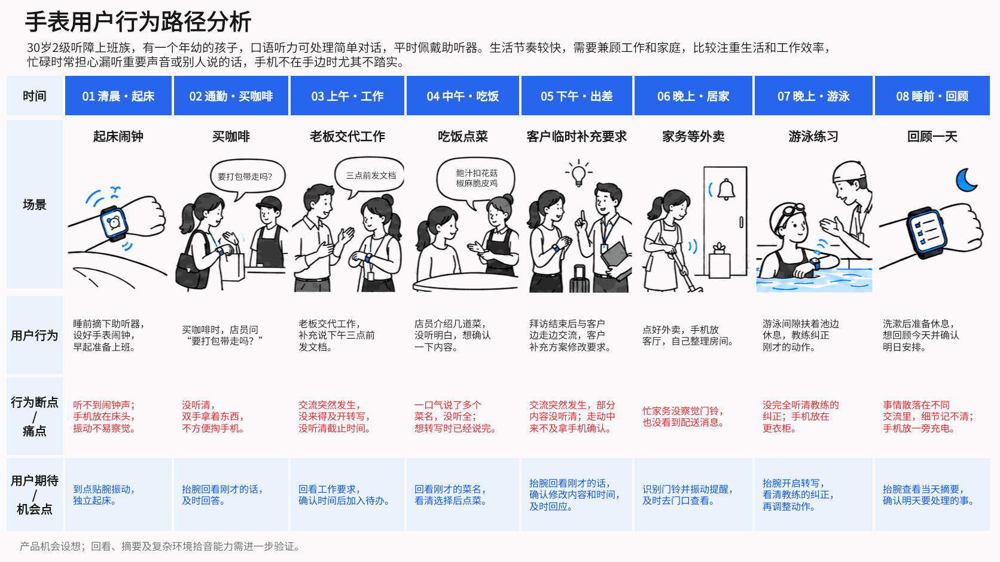

## 示例：听障用户的手表用户旅程

### 分析目标

梳理一位听障用户从早到晚的生活场景，寻找手表在声音提醒和语音转写方面能够发挥作用的时刻，并说明相对于手机的场景价值。

**用户画像（假设）**：30 岁二级听障上班族，有一个年幼的孩子，平时佩戴助听器，能够处理简单口语对话。生活节奏较快，兼顾工作与家庭；忙碌时担心漏听重要声音或别人的讲话，手机不在手边时尤其不踏实。

## 使用方法

把产品目标、目标用户、已有调研和关注的问题告诉 AI，例如：

> 帮我梳理智能门锁首次安装和使用的用户旅程。先分析用户行为、痛点和手机与门锁各自能提供的帮助，确认文案后再制作旅程图。

Skill 会根据任务梳理画像与场景，区分事实与假设，检查痛点是否成立，再依据需求制作可视化或可编辑的 PPTX。
